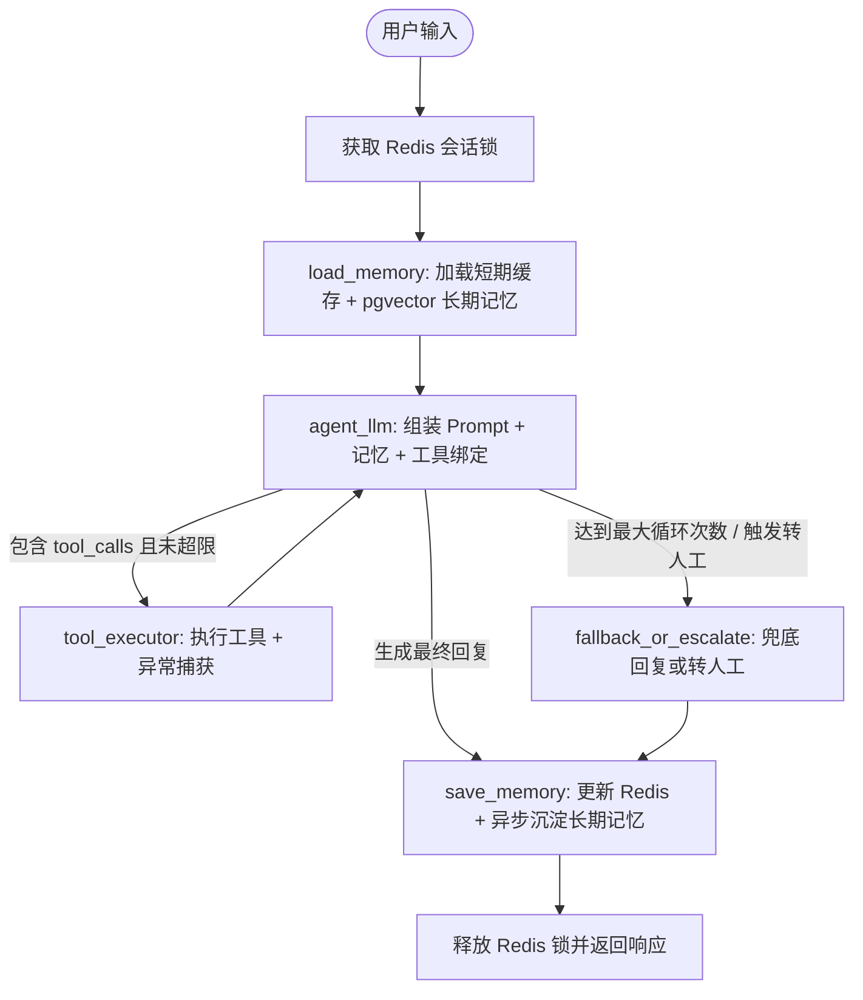

# 垂直客服 Agent — 第一阶段（Phase 1）实施计划

## 1. 阶段目标与边界

**第一阶段目标**：搭建垂直客服 Agent 的核心运行底座，跑通 **Agent Loop（状态机闭环）**、**分层记忆系统（短期 + 长期）** 与 **工具调用（Tool Calling）** 三大核心能力，支持多轮对话、上下文记忆召回、工具调用与异常兜底。

**Phase 1 范围界定（In-Scope / Out-of-Scope）**：
- **In-Scope**：LangGraph 编排闭环、Redis 短期记忆与并发锁、Postgres + pgvector 持久化状态与长期记忆、核心客服工具集（知识库检索 + 业务查询 + 工单/转人工）、FastAPI / CLI 测试入口、基础单测与集成测试。
- **Out-of-Scope（留待后续阶段）**：多渠道接入（微信/企微/网页 IM 网关）、高危写操作的人工审批流（HITL Interrupt）、前端管理后台、全链路监控大盘与自动评测流水线。

---

## 2. 技术栈职责划分

| 组件 | 核心职责 | Phase 1 具体用途 |
| :--- | :--- | :--- |
| **LangGraph** | Agent 编排与状态机引擎 | `StateGraph` 定义 Agent Loop、条件路由、循环次数熔断、`ToolNode` 调度、Checkpointer 状态持久化 |
| **Redis** | 高速缓存与并发控制 | 1. 活跃会话滑动窗口缓存（Hot Memory，带 TTL）<br>2. 会话级分布式锁（防同一用户并发消息竞态）<br>3. 请求幂等去重 & 只读工具短时缓存 |
| **PostgreSQL + pgvector** | 持久化存储与向量检索 | 1. LangGraph `AsyncPostgresSaver`（Thread 级断点续传与历史回溯）<br>2. 长期记忆表（用户画像/事实记忆 + 会话摘要向量检索）<br>3. 垂直领域知识库向量检索（FAQ / SOP）<br>4. 工具调用与对话审计日志 |

---

## 3. 核心模块详细设计

### 3.1 Agent Loop（LangGraph 状态机）



**核心状态定义（`AgentState`）**：
- `messages`: `Annotated[list[AnyMessage], add_messages]` — 对话消息流
- `user_id`: `str` — 用户唯一标识（用于长期记忆隔离）
- `session_id`: `str` — 会话标识（映射 LangGraph `thread_id`）
- `memory_context`: `dict` — 注入的用户画像、相关历史摘要
- `tool_call_count`: `int` — 当前轮次工具调用计数（用于 `MAX_ITERATIONS` 熔断，默认如 `5`）
- `needs_human`: `bool` — 是否触发转人工标记
- `error`: `str | None` — 异常上下文记录

**关键工程保障**：
- **防死循环**：每次进入 `tool_executor` 递增 `tool_call_count`，超过阈值强制路由到 `fallback_or_escalate`。
- **工具异常不崩溃**：工具执行捕获异常并转为结构化 `ToolMessage` 返回给 LLM，由 LLM 决定重试、换工具或向用户致歉。

---

### 3.2 分层记忆功能（Memory Architecture）

| 记忆层级 | 存储介质 | 生命周期 | 数据内容与检索方式 |
| :--- | :--- | :--- | :--- |
| **L1 工作记忆（Working Memory）** | Redis | 会话级（TTL 30m~24h） | 最近 $N$ 轮对话消息、当前活跃业务槽位（如 `current_order_id`），毫秒级读写 |
| **L2 会话状态（Thread Checkpoint）** | Postgres (`AsyncPostgresSaver`) | 持久化 | LangGraph 完整图状态快照，支持服务重启恢复、多轮上下文无损接续 |
| **L3 长期记忆（Long-term Memory）** | Postgres + `pgvector` | 跨会话持久化 | 1. **事实/画像记忆**：结构化用户属性与偏好（如 VIP 等级、历史高频诉求）<br>2. **情景记忆（Episodic）**：历史会话摘要 + Embedding，按 `user_id` 过滤后做余弦相似度 `top_k` 召回 |

**记忆读写策略**：
- **读（Turn 开始）**：先读 Redis 热上下文；若 Redis 未命中则从 Postgres Checkpointer 恢复；同时基于当前 query 从 pgvector 召回 Top-K 历史相关记忆注入 System Prompt。
- **写（Turn 结束）**：同步更新 Redis 滑动窗口；当对话达到一定轮次或会话结束时，触发摘要与关键事实提取（可异步执行），写入 Postgres + pgvector。

---

### 3.3 工具调用体系（Tool Calling）

**统一规范**：
- 所有工具使用 Pydantic 定义严格的入参 Schema，并编写清晰的 docstring（供 LLM 准确理解调用时机与参数含义）。
- 区分 **只读工具（Read）** 与 **写操作工具（Write）**，为 Phase 2 的人工确认（HITL）预留元数据标记。

**Phase 1 首批核心工具（垂直客服通用骨架，具体业务可替换）**：
1. `search_knowledge_base(query, category)` — 检索垂直领域 FAQ / 售后政策（基于 pgvector）。
2. `query_business_record(record_id / user_id)` — 查询核心业务单据（如订单/工单/预约状态，Phase 1 可先接 Mock Adapter）。
3. `create_ticket(user_id, summary, priority)` — 创建售后/跟进工单（带幂等键防重复创建）。
4. `transfer_to_human(reason, context_summary)` — 触发转人工，设置 `needs_human=True` 并生成交接摘要。

---

## 4. 建议工程目录结构

```text
├── docker-compose.yml          # Redis + Postgres (pgvector/pgvector:pg16)
├── pyproject.toml              # 依赖管理 (langgraph, langchain-*, redis, psycopg, pgvector, fastapi)
├── .env.example                # LLM Key, Redis URL, Postgres DSN, 阈值配置
├── src/
│   ├── config.py               # Pydantic Settings 配置中心
│   ├── db/
│   │   ├── postgres.py         # 连接池、pgvector 表结构初始化与迁移
│   │   └── redis.py            # Redis 客户端、分布式锁封装
│   ├── memory/
│   │   ├── short_term.py       # Redis 工作记忆读写与窗口裁剪
│   │   ├── long_term.py        # pgvector 情景记忆检索与事实提取写入
│   │   └── manager.py          # 统一 MemoryManager（聚合 L1/L2/L3）
│   ├── tools/
│   │   ├── base.py             # 工具基类/装饰器（超时控制、异常捕获、审计日志）
│   │   ├── knowledge.py        # 知识库检索工具
│   │   ├── business.py         # 业务查询/工单工具（含 Mock 实现）
│   │   └── escalation.py       # 转人工工具
│   ├── agent/
│   │   ├── state.py            # AgentState 定义
│   │   ├── prompts.py          # 垂直客服 System Prompt 模板
│   │   ├── nodes.py            # load_memory / agent_llm / tool_executor / save_memory
│   │   └── graph.py            # LangGraph StateGraph 组装与编译
│   └── api/
│       └── main.py             # FastAPI 对话接口（/chat, /health）
└── tests/
    ├── test_memory.py          # Redis + pgvector 记忆读写测试
    ├── test_tools.py           # 工具异常兜底与超时测试
    └── test_agent_loop.py      # 端到端多轮对话与工具调用闭环测试
```

---

## 5. 实施里程碑（Milestones）

- **M1：基础设施与数据模型（1~2 天）**
  - 完成 `docker-compose.yml`（Redis + pgvector）与 `.env` 配置。
  - 建表：知识库向量表、长期记忆向量表、用户事实表、工具审计表，启用 `vector` 扩展及 HNSW 索引。
- **M2：分层记忆层实现（2~3 天）**
  - 实现 Redis 滑动窗口缓存与会话分布式锁。
  - 接入 LangGraph `AsyncPostgresSaver` Checkpointer。
  - 实现 pgvector 长期记忆召回与对话摘要/事实沉淀逻辑。
- **M3：工具体系与 Agent Loop 编排（2~3 天）**
  - 实现 4 个核心工具及统一异常/超时包装器。
  - 编写 `StateGraph`，串联记忆加载、LLM 推理、工具路由、循环熔断、记忆回写。
  - 提供 FastAPI `/chat` 接口与简单 CLI 调试脚本。
- **M4：联调与验收测试（1~2 天）**
  - 编写并运行核心测试场景，验证多轮连续性、跨会话记忆召回、工具报错恢复及并发锁。

---

## 6. 第一阶段验收标准（Definition of Done）

1. **Agent Loop**：能稳定完成“用户提问 → 决策调用工具 → 获取结果 → 组织回答”闭环；当工具连续失败或达到最大循环次数（如 5 次）时，能优雅触发兜底回复而非死循环或报错崩溃。
2. **记忆功能**：
   - 同一会话内连续多轮追问（如指代消解“它什么时候发货”）上下文准确。
   - 重启服务后，使用原 `session_id` 可从 Postgres Checkpointer 无损恢复对话。
   - 开启新 `session_id`（同一 `user_id`）时，能从 pgvector 召回历史关键信息（如过往偏好或已登记问题）。
3. **工具调用**：参数校验失败或底层超时时，能返回友好提示或触发重试/转人工；同一请求并发发送不会导致状态错乱或重复建单。
