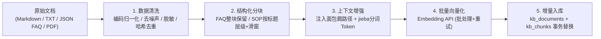
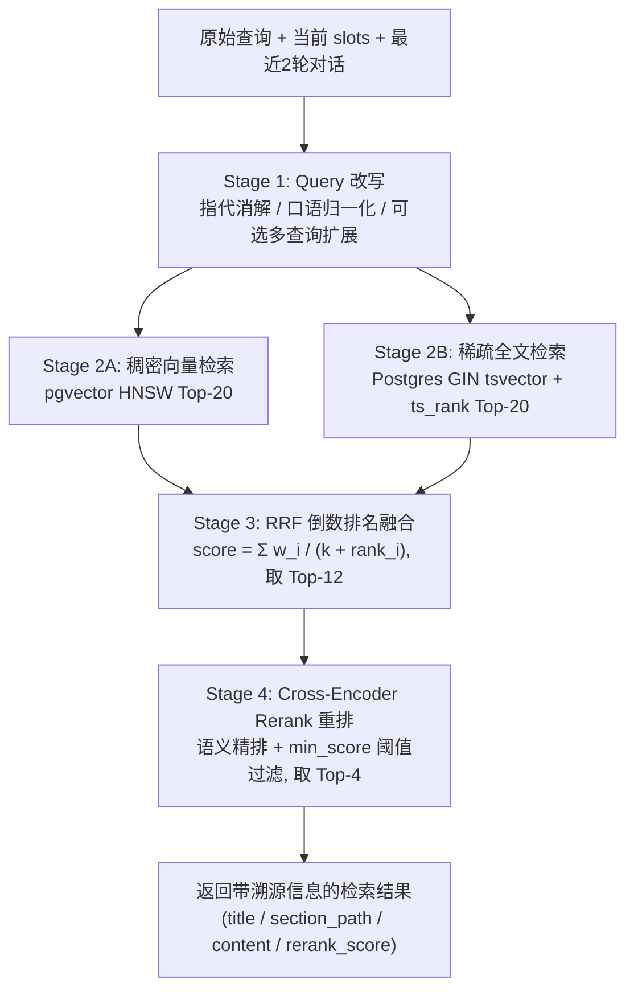

# 垂直客服 Agent — 第二阶段（Phase 2）实施计划

## 1. 阶段目标与演进定位

**第二阶段目标**：在 Phase 1 已跑通的 `LangGraph + Redis + PostgreSQL (pgvector)` 底座之上，重点补齐垂直客服系统的**“知识供给精度”**与**“线上可观测性”**两大短板，完整实现：
1. **知识库构建流水线（Ingestion Pipeline）**：多格式文档清洗、面向客服 SOP/FAQ 的结构化分块（Chunking）与增量入库。
2. **多级混合检索工具（Advanced RAG Tool）**：上下文感知 Query 改写 → 向量 + 全文混合检索 → RRF 融合 → Cross-Encoder Rerank 重排，显著降低政策问答幻觉与漏召回。
3. **Agent 全链路监测（Observability & Eval）**：Trace/Span 耗时与 Token 成本追踪、客服核心 SLA 指标聚合、Badcase 回溯接口及检索质量离线评测脚本。

**设计原则（延续 Phase 1 零额外重中间件原则）**：
- **全文检索直接复用 PostgreSQL**：通过 `jieba` 中文分词 + Postgres `tsvector` + `GIN` 索引实现稀疏关键词检索，与 `pgvector` HNSW 向量索引同库共存，**无需额外引入 Elasticsearch**。
- **监测全面接入 Langfuse**：使用 **Langfuse** 作为全链路可观测平台（支持 Langfuse Cloud 或本地 Docker 自托管），结合轻量指标聚合，覆盖全链路 Trace/Span、工具监控、Token 消耗与 TPS（生成吞吐 & 系统请求吞吐）监控。

---

## 2. 模块一：知识库构建（数据清洗 + Chunking + 增量索引）

### 2.1 数据处理流水线



### 2.2 数据清洗规则（`src/kb/cleaner.py`）
1. **格式与字符归一化**：统一 UTF-8 与换行符、NFKC 全角转半角、剥离残留 HTML 标签与不可见控制字符、折叠连续空白行。
2. **文档噪声剔除**：支持按正则剔除页眉/页脚、页码水印（如 `第 X 页 / 共 Y 页`）、无效装饰分隔线。
3. **PII 敏感信息脱敏**：入库前自动检测并脱敏测试文档中残留的真实手机号、身份证号、邮箱、银行卡号，防止内部知识库泄露隐私。
4. **内容指纹与幂等增量**：对清洗后的全文计算 `sha256`（`content_hash`）；若 `doc_key` 已存在且 `content_hash` 未变化则跳过重算 Embedding，显著节省成本。

### 2.3 面向垂直客服的 Chunking 策略（`src/kb/chunker.py`）
不同客服语料不能“一刀切”按固定字数硬截断，Phase 2 区分两种切分模式：
- **模式 A：FAQ 问答对模式（Atomic QA）**
  - 每条 `Q + A` 保持为独立完整 Chunk，绝不从问题和答案中间劈开；附加 `category`、`tags` 元数据。
- **模式 B：长文 SOP / 售后规则模式（Markdown Heading + Recursive Overlap）**
  - 先按 Markdown 标题层级（`# / ## / ###`）切分为逻辑段落，记录面包屑路径（如 `退换货政策 > 质量问题 > 运费承担`）。
  - 超出 `chunk_size`（默认 `400~500` 字符，`overlap=60~80` 字符）的段落按中文句界（`。！？；\n`）递归切分，**不截断完整句子或 Markdown 表格行**。
  - **上下文前缀增强**：在每个 Chunk 头部拼接 `【{title} | {section_path}】`，避免孤立分段丢失主语（例如单看“由平台承担”不知道指的是哪种场景的运费）。

### 2.4 数据库表结构演进（PostgreSQL）
在 Phase 1 基础上升级知识库表结构（文档表 + 分块表分离）：
- **`kb_documents`**（文档主表）：`id`, `doc_key (UNIQUE)`, `title`, `category`, `source_type`, `content_hash`, `version`, `status (active/archived)`, `metadata (JSONB)`, `updated_at`
- **`kb_chunks`**（检索分块表）：
  - `id`, `document_id (FK -> kb_documents ON DELETE CASCADE)`, `chunk_index`, `section_path`, `content`（正文）, `enriched_content`（带标题面包屑的检索文本）
  - `search_tokens TEXT`（`jieba` 分词后的空格分隔词串，供中文全文检索）
  - `search_tsv TSVECTOR GENERATED ALWAYS AS (to_tsvector('simple', search_tokens)) STORED` + **GIN 索引**
  - `embedding vector(dim)` + **HNSW (`vector_cosine_ops`) 索引**
  - `metadata (JSONB)`

---

## 3. 模块二：高级检索工具（Query 改写 + 混合检索 + RRF + Rerank）

### 3.1 四阶段检索流水线



### 3.2 各阶段关键工程设计（`src/retrieval/`）

1. **Query 改写（`rewriter.py`）**
   - **输入**：用户当前 query + `AgentState["slots"]`（如 `product_name: 声学降噪耳机 Pro`）+ 最近 2 轮对话。
   - **能力**：
     - **指代消解与槽位补全**：将“它坏了能换新吗？”改写为“声学降噪耳机 Pro 出现故障换新质保政策”。
     - **口语/同义词归一化**：将“邮费谁掏”“能不能退钱”补全为标准检索词（“运费承担”“退换货退款规则”）。
     - **延迟保护与降级**：支持快速跳过（独立清晰 query 可不触发或走轻量模型）与超时降级（改写失败自动回退原始 query，绝不阻塞检索）。
   - **状态传递**：升级 `tool_executor`，向 `search_knowledge_base` 注入只读的会话摘要/槽位上下文（不暴露给 LLM 额外复杂入参，保持工具 Schema 简洁）。

2. **混合检索（`hybrid.py`）**
   - **Dense 路（语义匹配）**：对改写后的 query 计算 Embedding，在 `kb_chunks` 上做 `embedding <=> query_vec` 余弦检索，召回 `dense_top_k = 20`（支持 `category` 过滤）。
   - **Sparse 路（精确词面匹配）**：使用 `jieba.cut_for_search` 对改写 query 分词，构造 Postgres `plainto_tsquery / to_tsquery('simple', ...)` 在 `search_tsv` 上用 `ts_rank_cd` 排序，召回 `sparse_top_k = 20`。专门解决向量对**商品型号（如 `X100`）、错误码、专有名词、数字天数（`7天`/`15天`）**不敏感的痛点。
   - 两路检索通过 `asyncio.gather` **并行执行**。

3. **RRF 融合（`fusion.py`）**
   - 采用 Reciprocal Rank Fusion 公式，天然免去两路分数尺度不一致的归一化难题：
     $$\text{RRF}(d) = \frac{w_{\text{dense}}}{k + \text{rank}_{\text{dense}}(d)} + \frac{w_{\text{sparse}}}{k + \text{rank}_{\text{sparse}}(d)}$$
   - 默认 $k = 60$，$w_{\text{dense}} = 1.0$，$w_{\text{sparse}} = 1.0$（可通过 `.env` 调优），融合去重后输出候选 `rrf_top_k = 12`。

4. **Rerank 重排（`reranker.py`）**
   - 定义统一 `Reranker` Protocol，提供三种实现按配置切换：
     1. **`APIReranker`（推荐生产默认）**：适配标准 HTTP `/rerank` 接口（兼容 Cohere / Jina / SiliconFlow `BAAI/bge-reranker-v2-m3` / DashScope / 本地 TEI/vLLM Rerank 服务）。
     2. **`LLMReranker`（无专用 Rerank Key 时备选）**：使用轻量 LLM 批量打分。
     3. **`PassthroughReranker`（降级兜底）**：当 Rerank API 超时或未配置时，自动降级保留 RRF 排序结果，确保高可用。
   - **阈值截断（Low-Confidence Filter）**：过滤低于 `rerank_min_score` 的候选块；若全部低于阈值，明确返回“知识库无高置信度命中”，引导 Agent 避免胡编并建议转人工。

---

## 4. 模块三：Agent 全链路监测（基于 Langfuse）

### 4.1 监测目标与 Langfuse 映射关系

| 监控诉求 | Langfuse 实现方式 | 能看清什么问题 |
| :--- | :--- | :--- |
| **全链路 Trace（慢在哪、错在哪）** | **Trace + 嵌套 Span 瀑布流** | 一眼看清单轮对话每个节点耗时占比（`load_memory` / `agent_llm` / `tool_executor` / 检索 4 阶段 / `save_memory`），错误节点自动标红 `level="ERROR"` 并附带完整堆栈与输入输出 |
| **工具调用监控** | **Tool Span + `tool_audit_logs`** | 每次工具调用记录工具名、入参、返回摘要、耗时、`status`（`success` / `cache_hit` / `timeout` / `validation_error` / `exception`），快速统计工具失败率与慢查询 |
| **Token 消耗监控** | **Langfuse `Generation` Span** | 自动采集每次 LLM 调用的 `input_tokens`、`output_tokens`、`total_tokens` 与模型费用估算，按 `user_id` / `session_id` / 模型聚合看板 |
| **TPS 监控（双维度）** | **生成速度 TPS + 系统请求 TPS** | 1. **LLM 生成吞吐（Tokens/s）**：记录每次 `agent_llm` 的 `output_tokens / generation_duration_s` 与首字延迟（TTFT），作为 `Score` & Metadata 上报 Langfuse<br>2. **系统请求吞吐（Req/s）**：基于 Redis/内存滑动窗口统计接口实时 RPS/TPS、成功 TPS、错误 TPS 与 P50/P95 延迟，暴露 `/metrics/summary` |

### 4.2 全链路 Trace 树结构示例

```text
Langfuse Trace (trace_id, session_id, user_id, tags=["phase2", "cs-agent"])
 ├── Span: load_memory (12ms)                  # 记录 redis_cache_hit, 召回长期记忆条数
 ├── Generation: agent_llm #1 (620ms)          # 自动采集 prompt/completion tokens + tokens/s
 ├── Span: tool_executor -> search_knowledge_base (480ms, status=success)
 │    ├── Span: retrieval_rewrite (210ms)      # 记录 original_query -> rewritten_query
 │    ├── Span: retrieval_dense (18ms)         # 记录 pgvector 召回条数
 │    ├── Span: retrieval_sparse (14ms)        # 记录 jieba + GIN 召回条数
 │    ├── Span: retrieval_rrf (2ms)            # 记录融合去重后候选数
 │    └── Span: retrieval_rerank (230ms)       # 记录 top1_score, zero_hit 标记
 ├── Generation: agent_llm #2 (850ms)          # 生成最终回复 + tokens/s
 ├── Span: save_memory (8ms)                   # L1 同步落盘 + 是否触发 L3 异步沉淀
 └── Scores: llm_tps, rerank_top1_score, zero_hit, needs_human
```

### 4.3 低侵入接入架构（`src/observability/`）

1. **Langfuse 客户端与回调封装（`langfuse_client.py`）**：
   - 在应用启动时初始化 `Langfuse` 单例；每轮 `CustomerServiceAgent.chat()` 创建 Trace 上下文并构造 Langfuse `CallbackHandler`（注入 `session_id`、`user_id`、`trace_id`），通过 `config={"callbacks": [handler]}` 传入 LangGraph，自动捕获图节点与 LLM Generation。
   - **安全降级（No-op 模式）**：当 `LANGFUSE_ENABLED=false` 或未配置 Key（以及自动化测试环境）时，自动切换为空操作实现，**不阻塞服务启动，也不影响对话主链路**。
2. **自定义 Span 与错误/慢节点定位（`tracing.py`）**：
   - 通过 `contextvars.ContextVar` 向下透传当前 `trace / parent_span`，在 `retrieval/pipeline.py`（4 阶段）和 `tools/base.py`（工具护栏）中创建精细子 Span。
   - 发生工具超时、异常、低分空召回或循环熔断时，自动标记 `level="ERROR"` / `"WARNING"` 并写入 `status_message`，在 Langfuse 看板中可直接按错误等级筛选 Badcase。
3. **TPS 与业务 KPI 统计（`metrics.py`）**：
   - **LLM Tokens/s**：在 `Generation` 回调中计算单次与整轮平均生成速度 `tokens_per_sec`，通过 `langfuse.score()` 写入 Trace 评分，支持在 Langfuse 绘制 TPS 趋势图。
   - **系统请求 TPS & 延迟聚合**：维护轻量级滑动窗口（60s / 15m / 24h），统计请求 TPS（req/s）、平均 Token 消耗、工具成功率、空召回率、转人工率与 P50/P95 延迟，通过 `GET /metrics/summary` 暴露（可直接对接 Prometheus/监控面板）。

### 4.4 新增接口与部署支持
- `GET /metrics/summary?window_seconds=3600` — 返回实时系统 TPS、平均 LLM Tokens/s、Token 总消耗、P50/P95 延迟、工具超时/失败率、检索空召回率、转人工率。
- `POST /kb/ingest` — 触发单文档/批量文档清洗、切分与增量入库。
- `docker-compose.yml` 可选 profile（`--profile langfuse`）预留自托管 Langfuse 示例配置，或直接填写 Langfuse Cloud `PUBLIC_KEY` / `SECRET_KEY` 使用。

### 4.5 检索质量离线评测套件（`evals/`）
- 内置 15~20 条垂直电商售后 Golden 测试用例（含口语化问法、代词指代、型号精确匹配、知识库外拒答题）。
- 提供 `scripts/eval_retrieval.py`：对比 **Pure Vector（Phase 1）** vs **Rewrite + Hybrid + RRF + Rerank（Phase 2）** 的 `Recall@3`、`MRR@5`、`Zero-Hit Accuracy`（库外问题拒答率）及平均检索耗时，用量化数据验证收益。

---

## 5. 新增与调整的工程目录结构

```text
├── src/
│   ├── kb/                          # [NEW] 知识库构建模块
│   │   ├── cleaner.py               # 数据清洗、噪声去除、PII脱敏、SHA256指纹
│   │   ├── chunker.py               # FAQ 整块切分 & Markdown 标题层级+滑窗切分
│   │   ├── tokenizer.py             # jieba 中文分词器封装（供入库与稀疏检索共用）
│   │   └── ingestion.py             # 批量 Embedding + kb_documents/kb_chunks 事务增量入库
│   ├── retrieval/                   # [NEW] 高级混合检索流水线
│   │   ├── models.py                # RetrievalCandidate, RetrievalResult, RetrievalDiagnostics
│   │   ├── rewriter.py              # 上下文/槽位感知 Query 改写器（含降级策略）
│   │   ├── hybrid.py                # Postgres pgvector Dense + GIN tsvector Sparse 并行检索
│   │   ├── fusion.py                # RRF 倒数排名融合算法
│   │   ├── reranker.py              # Reranker 协议 + APIReranker / Passthrough 降级实现
│   │   └── pipeline.py              # 串联 4 阶段 + 写入检索子 Span 监测
│   ├── observability/               # [NEW] Langfuse 全链路监测与 TPS 指标模块
│   │   ├── langfuse_client.py       # Langfuse 客户端管理、CallbackHandler 构建与 No-op 降级
│   │   ├── tracing.py               # ContextVar 链路透传、检索/工具自定义 Span & 错误标注
│   │   └── metrics.py               # Token 统计、LLM Tokens/s (TPS) 与系统请求 TPS 滑动窗口聚合
│   ├── db/postgres.py               # [MODIFY] 新增 kb_chunks 建表与 GIN + HNSW 索引
│   ├── tools/knowledge.py           # [MODIFY] 将 search_knowledge_base 升级接入 RetrievalPipeline
│   ├── tools/base.py                # [MODIFY] 工具执行护栏接入 Langfuse Tool Span 监控
│   ├── agent/nodes.py & graph.py    # [MODIFY] 接入 Langfuse CallbackHandler、LLM TPS 采集与检索上下文透传
│   ├── api/main.py                  # [MODIFY] 新增 /kb/ingest, /metrics/summary
│   └── config.py                    # [MODIFY] 新增 Chunking、RRF/Rerank API、Langfuse 配置项
├── scripts/
│   ├── seed_kb.py                   # [MODIFY] 改为走 IngestionPipeline（含长文 SOP + FAQ 示例）
│   └── eval_retrieval.py            # [NEW] 检索质量离线对比评测脚本
├── evals/
│   └── golden_retrieval.json        # [NEW] 垂直电商客服检索评测集
└── tests/
    ├── test_kb_ingestion.py         # [NEW] 清洗、脱敏、切分、增量去重测试
    ├── test_retrieval.py            # [NEW] Query 改写、混合检索、RRF 数学正确性、Rerank 降级与阈值测试
    └── test_observability.py        # [NEW] Trace/Span 树、Token 统计、KPI 聚合与 API 测试
```

---

## 6. 实施里程碑（Milestones）

- **M1：数据库 Schema 演进与知识库构建流水线（2 天）**
  - 扩展 `init_db()`：升级 `kb_documents` 并新增 `kb_chunks`（含 `search_tsv` GIN + `embedding` HNSW 索引）。
  - 实现 `cleaner.py`、`chunker.py`、`tokenizer.py`、`ingestion.py`，升级 `scripts/seed_kb.py` 并通过 `test_kb_ingestion.py`。
- **M2：多级混合检索流水线与工具升级（2~3 天）**
  - 实现 `rewriter.py`、`hybrid.py`、`fusion.py`、`reranker.py`、`pipeline.py`。
  - 升级 `search_knowledge_base` 与 `tool_executor` 槽位上下文透传，通过 `test_retrieval.py`。
- **M3：Langfuse 全链路监测、工具监控与 TPS 统计（1~2 天）**
  - 引入 `langfuse` SDK，实现 `langfuse_client.py`、`tracing.py`、`metrics.py`。
  - 打通全链路 Trace/Span（含检索 4 阶段与工具错误高亮）、Token 统计、LLM `tokens/s` 与系统请求 `req/s` TPS 监控，新增 `/metrics/summary` 与 `/kb/ingest`，通过 `test_observability.py`。
- **M4：端到端回归测试与检索离线评测（1 天）**
  - 运行 `eval_retrieval.py` 验证混合检索 + Rerank 相比纯向量的指标提升。
  - 全量 `pytest` + `ruff` 验收，保证 Phase 1 全部 13 项用例与 Phase 2 新增用例 100% 通过。

---

## 7. 第二阶段验收标准（Definition of Done）

1. **知识库构建**：
   - 导入含 HTML 噪声、多余空行、测试手机号的长文 SOP 与 FAQ 文档时，能自动完成清洗、脱敏、语义分块并注入标题面包屑；重复导入相同内容能命中 `content_hash` 跳过重复 Embedding。
2. **混合检索与重排**：
   - 指代型追问（如“它支持质保吗？”）能结合 `slots` 正确改写后再检索。
   - 精确词查询（如型号/规则数字）与语义泛化查询均能通过 `Dense + Sparse -> RRF -> Rerank` 命中目标 Chunk；当 Rerank 服务超时或报错时能无感降级到 RRF 排序，不中断对话；库外无关查询能被低分阈值正确拦截。
3. **Langfuse 全链路监测**：
   - 每次 `/chat` 在 Langfuse 生成完整嵌套 Trace（覆盖图节点、LLM Generation、工具调用与检索 4 阶段），慢节点耗时与错误堆栈清晰可见；Token 消耗、LLM `tokens/s` 与系统请求 TPS（`/metrics/summary`）统计准确；未配置 Langfuse Key 或上报异常时自动 No-op 降级，不影响用户正常对话。
